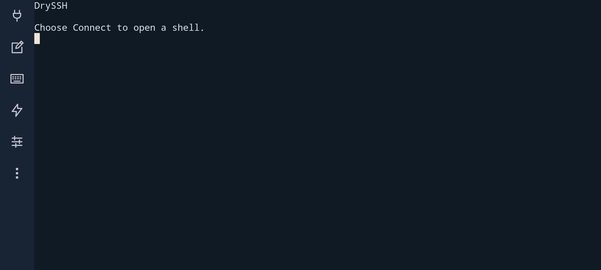

# DrySSH

A terminal-first Android SSH client for phones and external keyboards.
Connect to a server, keep a shell open, and work with tools such as tmux and nvim.
No server-side helper is required.



## Features

- Saved connection profiles with password or private-key authentication, including
  encrypted keys, and host-key verification before authentication.
- One active session, configurable reconnect and strict WLAN-only networking.
- Local IME composition and a multiline editor with negotiated bracketed paste.
- Configurable keyboard shortcuts, font import and 179 offline Alacritty themes.
- Adaptive portrait/landscape controls, touch selection, history and clipboard.
- Android Keystore encrypted credentials and foreground-session controls.

## Install

Requires **Android 11 (API 30) or later**, on ARM64 or x86_64.
Download the signed APK from this repository's **Releases** page when available,
verify it against `SHA256SUMS`, and open it with Android's package installer.
The first public version is a preview; see [release notes](changelog.d/0.1.0.md).

The maintainer has tested basic functionality on an ARM64 physical device.
Automated emulator acceptance covers SSH, input, terminal workflows and network
policy; [verification details and limits](docs/progress.md) record the scope.

Reconnection starts a fresh shell. Process termination loses the active session
and editor draft. Jump hosts, Mosh, multiple active sessions and configuration
backup/export are outside this release. Uninstalling removes profiles and
credentials; retain your original private keys.

## Quick start

Open the plug icon to save a connection and connect. Verify a new server's
fingerprint through a trusted channel before accepting it. The pencil opens the
local editor; Ctrl+Shift+E is its default shortcut. Enter inserts a newline and
Shift+Enter pastes without sending a trailing Enter. Esc keeps the draft.

The keyboard icon toggles the IME; the lightning icon opens auxiliary keys/actions.
Settings contains themes, fonts, shortcuts and quick actions. The session menu
contains screen-awake and disconnect controls. Swipe from a screen edge to reveal
Android's system bars temporarily.

## Build from source

Use JDK 21, the Rust toolchain pinned in `rust-toolchain.toml`, Android SDK Platform
37.0, Build Tools 36.0.0, CMake 3.22.1 and NDK 29.0.14206865. Python 3.11+ is required.
The checksum-pinned Gradle wrapper downloads Gradle.

```sh
sdkmanager 'platforms;android-37.0' 'build-tools;36.0.0' 'cmake;3.22.1' 'ndk;29.0.14206865'
export ANDROID_HOME=/path/to/android-sdk
export ANDROID_NDK_HOME="$ANDROID_HOME/ndk/29.0.14206865"
python3 android/build.py
adb install -r target/android/dryssh-debug.apk
```

The default build contains ARM64 and x86_64. `--abi arm64-v8a` or `--abi x86_64`
builds one architecture. `--release` optimizes Rust and produces one **unsigned**
APK per ABI, each carrying only that ABI's `libdryssh.so`; debug builds keep a
single APK containing both architectures. [Release instructions](docs/releasing.md)
cover dedicated signing and archives.
Debug certificates are for local development only.

Use `--gradle-arg=OPTION` for local proxy/AAPT2 overrides. On NixOS, the NDK, CMake,
AAPT2 and emulator need an FHS environment or patched native executables.

## Development

[Build checks and device acceptance](docs/development.md) describe how to run the
Rust, Android and OpenSSH fixture suites. GitHub CI checks formatting, lint and
unit/integration tests, scans Git history, and builds both native architectures.
Its unsigned per-ABI APK artifacts are intended for build verification.

The Rust core owns SSH, profiles/settings and connection policy. Android owns
network selection, the foreground service and Keystore-backed credentials.
Credentials are encrypted in `noBackupFilesDir`; there is no plaintext fallback.
Application logs contain state transitions and route information, excluding
credentials and terminal transcripts.

## License

DrySSH's own code is [MIT licensed](LICENSE). Third-party components retain their
licenses; see [third-party notices](NOTICE.md), [terminal source and local
patches](android/terminal/UPSTREAM.md), and [bundled themes](android/THEMES.md).
